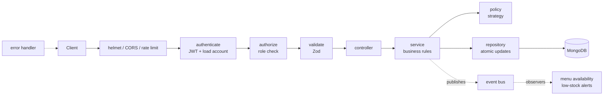
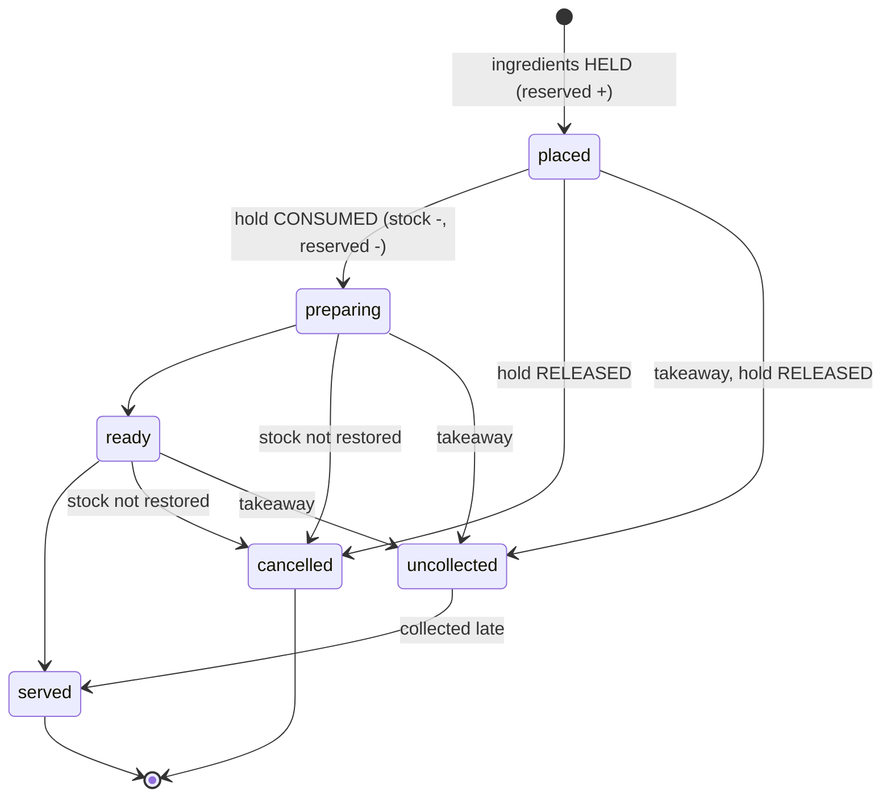
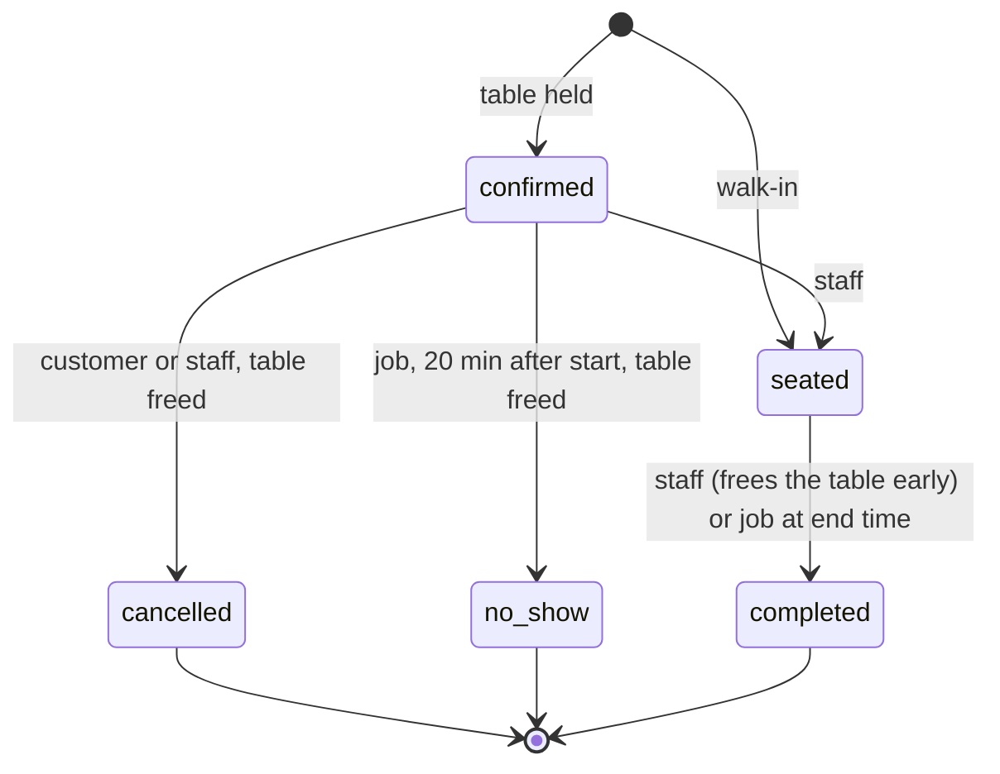
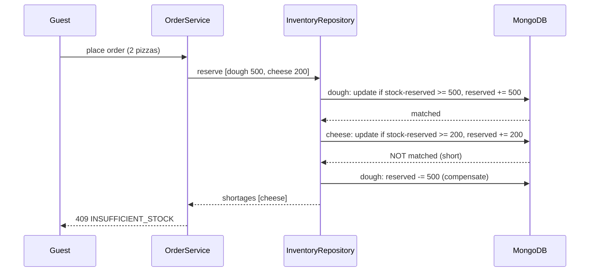

# Architecture

## Request flow

Each box before the controller is a link in a chain: it either rejects the request (with a uniform JSON error) or passes it on. Routes declare their chain once (`routes/index.js`), and the same declaration produces the API documentation.

## Order lifecycle and what happens to stock

`uncollected` is set only by the background job; staff drive `preparing`, `ready` and `served`; customers and staff can cancel.

## Reservation lifecycle

Only `confirmed` and `seated` reservations occupy a table.

## Holding stock safely

Every arrow to MongoDB is a single-document atomic update, so no two requests can interleave inside one check-and-change.

## Why some choices were made

- **Services never see `req`/`res`.** Business rules are tested by calling the API or the service with a fake clock.
- **The clock is injected.** Opening hours, grace periods and "20 minutes after" rules are tested to the second without waiting.
- **Atomic operations live in repositories**, not services, because they depend on MongoDB behaviour (conditional updates, update pipelines, a partial unique index).
- **Events are awaited but isolated.** Menu availability must be correct when the response is sent, so publishers wait for subscribers; a failing subscriber is logged and cannot fail the request.
- **Docs come from the validators.** Zod schemas validate requests and are converted to the OpenAPI document, so documented and enforced inputs cannot differ.
